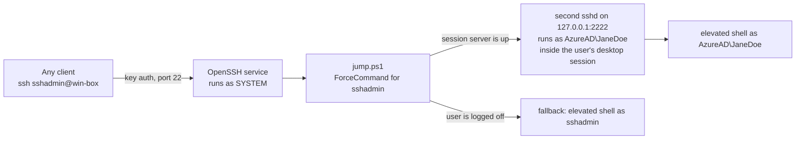

# SSH into an Entra ID user's Windows session

Key-based, passwordless SSH that lands you **elevated, as a cloud-only Microsoft Entra ID (Azure AD) user, inside that user's own desktop session**, on an Entra-joined Windows 10/11 PC. No domain controller, no Azure Arc, and no special configuration on the clients.

```console
$ ssh sshadmin@win-box whoami
azuread\janedoe
```

Windows' built-in OpenSSH server can't do this on its own. This repo documents why, everything we tried, and the workaround we ended up with, plus scripts that set it up.

## The problem

On an Entra-joined PC with no on-prem Active Directory, key-based SSH **as the Entra account** always fails. The client is told its key was accepted, and then the connection drops:

```
debug1: Server accepts key: ED25519 SHA256:...
Authenticated to win-box ([192.0.2.20]:22) using "publickey".
Read from remote host win-box: Connection reset by peer
```

The server log (`C:\ProgramData\ssh\logs\sshd.log`) shows why:

```
Accepted publickey for AzureAD\\janedoe from 192.0.2.10 port 51334 ssh2: ED25519 SHA256:...
error: lookup_principal_name: User principal name lookup failed for user 'azuread\\janedoe' (explicit: 1355, implicit: 1355)
error: get_user_token - unable to generate token on 2nd attempt for user azuread\\janedoe
error: unable to get security token for user azuread\\janedoe
fatal: fork of unprivileged child failed
```

The OpenSSH service runs as SYSTEM. Once it has verified a key it still has no password, so it asks Windows for a logon token for the user through **S4U** (Service-for-User). Windows can't resolve a cloud-only Entra account to a domain (error 1355, `ERROR_NO_SUCH_DOMAIN`), so no token is created and the session dies. Authentication succeeded; the *logon* can't happen. Microsoft's OpenSSH for Windows documentation lists authentication with a Microsoft Entra account as not currently supported.

Two things do work:

- **Password** login as the Entra account. sshd calls `LogonUser` with the real password, and Windows' cloud authentication provider validates it against Entra. No S4U is involved.
- **Key** login as a **local** account.

## What we tried

| Attempt | Result | Why |
|---|---|---|
| sshd inside WSL2, with `netsh portproxy` on port 22 | Connections died about a minute after the WSL window closed | The WSL VM shuts down when it's idle |
| Key login as `AzureAD\JaneDoe` | Key accepted, then the connection resets | No S4U token for a cloud-only account (above) |
| Password login as `AzureAD\JaneDoe` | **Works** | `LogonUser` with the real password; no S4U |
| The stock `Match Group administrators` block | Entra logins reset even with a password | Group matching needs the user's token *before* auth, which hits the same S4U wall. Per-user `Match User` blocks fix it. |
| UPN login (`jane@contoso.com`) | "Invalid user" / closed at preauth | Mapping a UPN needs a domain controller |
| PowerShell 7 as the default shell | No change | The token step happens before any shell starts. Verified live with PowerShell 7.6.9 set as the default shell. |
| `runas`, `runas /netonly`, S4U from a SYSTEM service | Can't mint a token for a cloud-only account (from research; not tested here) | Same root cause |
| SSH certificates (e.g. step-ca) | Not tried | To sshd a certificate is still public-key auth, so we'd expect the same post-auth failure |
| Azure Arc + `az ssh arc` | Not tried | Microsoft's supported identity-based route; heavy for one PC |
| **A second sshd inside the user's session, reached by a server-side jump** | **Works: passwordless, elevated, no client config** | That sshd already holds the user's token, so Windows never has to create one |

## How the workaround works



1. **A second sshd runs inside the user's desktop session.** A logon scheduled task starts it as that user, with `LogonType Interactive` and `RunLevel Highest`. Interactive means it uses the session's existing token and stores no password; Highest means it runs elevated. Because this sshd already *is* the user, it can accept that user's key without asking Windows for a new token. It listens on port 2222.
2. **You SSH in as a local administrator.** Key logins for local accounts work normally on port 22.
3. **`ForceCommand` hops you into the session.** Every login by the local admin runs `jump.ps1`. It connects to `127.0.0.1:2222` as the Entra user using a jump key that never leaves the PC and is accepted only from localhost. If you gave a command, it's passed through. scp/sftp are served directly as the local admin.
4. **Fallback.** If the session server isn't running (the user is logged off, or the PC just rebooted), `jump.ps1` keeps you in a plain elevated shell as the local admin, so you're never locked out.

Because the jump happens on the server, every client just runs `ssh sshadmin@win-box`: no ProxyJump entries and no per-client config.

## Requirements

- Windows 10/11 with the built-in OpenSSH Server. Tested on Windows 11 Pro 23H2 with OpenSSH for Windows 9.5.
- An Entra-joined PC where the Entra user is a **local administrator**. That's what makes their session elevated.
- An elevated **Windows PowerShell 5.1** prompt on the PC (console or RDP) for the setup.
- Your SSH public key.

## Setup

1. Copy the `scripts` folder to the PC and edit **`config.ps1`**: the Entra user, their profile folder, the local admin name, and your public key.
2. Open **Windows PowerShell as Administrator** in that folder:

   ```powershell
   Set-ExecutionPolicy -Scope Process Bypass
   .\00-install-openssh.ps1 -WithLocalAdmin   # OpenSSH on :22, key-only, per-user Match blocks, local admin
   ```

3. From your laptop, log in once as the local admin. This proves the base works and creates the admin's profile, which 02 needs:

   ```sh
   ssh sshadmin@win-box whoami        # -> win-box\sshadmin
   ```

4. Back on the PC, **with the Entra user logged on**:

   ```powershell
   .\01-install-session-sshd.ps1      # session sshd + logon task; prints who it runs as
   .\02-install-jump.ps1              # jump key + jump.ps1; ends by proving the hop (user, then True)
   .\03-enable-forcecommand.ps1       # route the local admin's logins through jump.ps1
   .\04-set-pwsh7-default-shell.ps1   # optional, see below
   ```

5. From any client:

   ```sh
   ssh sshadmin@win-box whoami        # -> azuread\janedoe
   ```

Run the scripts from the console or RDP, not through the jump. 01 restarts the session server (and `uninstall.ps1` removes it), which would cut off a session that came in through it.

## Using it

```sh
ssh sshadmin@win-box                                   # interactive, elevated, as the Entra user
ssh sshadmin@win-box 'Get-Process | Select -First 5'   # one-off command (runs in Windows PowerShell 5.1)
scp report.csv sshadmin@win-box:C:/Users/JaneDoe/      # scp/sftp run as the local admin
```

- From bash/zsh, single-quote remote commands so `$` reaches PowerShell intact.
- Send **plain-text** commands. `jump.ps1` base64-encodes your command once for the hop. If you send `powershell -EncodedCommand ...` yourself, it gets encoded twice, and Windows Defender kills that (see Gotchas).
- Commands run in the user's real desktop session, with their profile, their environment, and an elevated token.

## Optional: PowerShell 7 as the interactive shell

`04-set-pwsh7-default-shell.ps1` points OpenSSH's `DefaultShell` at PowerShell 7, so interactive sessions open in `pwsh` instead of Windows PowerShell 5.1, which also gets rid of its "Install the latest PowerShell" banner. It needs the **MSI** build at `C:\Program Files\PowerShell\7\pwsh.exe`. The Microsoft Store build is an app alias inside one user's profile and can't be the OpenSSH shell.

`winget install Microsoft.PowerShell` can give you the Store/MSIX package instead of the MSI. Once the MSIX was installed, winget refused the MSI for us ("No applicable installer found"). In that case, install the MSI from the [PowerShell releases](https://github.com/PowerShell/PowerShell/releases).

This changes the shell only. It does **not** make direct Entra key logins work.

## Gotchas (we hit all of these)

- **A `DefaultShell` that doesn't exist locks everyone out.** sshd refuses every login with "User X not allowed because shell ... does not exist". Check `Test-Path` before you set it; 04 does.
- **Never give the Entra user an `AuthorizedKeysFile` on the main sshd.** The client offers the key, sshd accepts it, the session crashes, and the client never falls back to the password prompt.
- **No `Match Group` blocks** on a PC where Entra users log in. See "What we tried".
- **`StrictModes` isn't supported** by OpenSSH for Windows; leave it out.
- **sshd_config changes apply to the next connection.** In our testing with 9.5, no service restart was needed. Validate first: `sshd -t -f C:\ProgramData\ssh\sshd_config`.
- **Restarting sshd from inside an SSH session** kills the restart along with your session. Spawn it outside the session:
  `Invoke-CimMethod -ClassName Win32_Process -MethodName Create -Arguments @{CommandLine='powershell -Command Start-Sleep 2; Restart-Service sshd'}`
- **Defender and double-encoded PowerShell.** A `powershell -EncodedCommand` whose payload is another `powershell -EncodedCommand` is detected as `Trojan:Win32/Commando.C!ml` and killed. To the SSH client it just looks like empty output. Send plain text through the jump. If output vanishes, check `Get-MpThreatDetection`. Fix the double encoding rather than adding exclusions.
- **The session server only exists while the user is logged on.** After a reboot, admin logins get the fallback shell until the user logs on.
- **We didn't rely on SSH agent forwarding for the hop.** It isn't dependable with OpenSSH for Windows, so the jump uses a key that lives on the PC.

## Security notes

- **Your admin key becomes the user.** Anyone holding the local admin's SSH key gets an elevated shell as the Entra user, with that user's files, browser profiles, and cached sign-ins. Protect it accordingly: a hardware key, or an agent-held key with a passphrase.
- **The jump key has no passphrase.** It lives in the local admin's profile and is accepted only from `127.0.0.1`/`::1`. Anyone who can read it is already an administrator on the PC.
- **The session server's `authorized_keys` also lists your admin key, with no `from=` restriction.** It's reachable from the network only if you ran 01 with `-OpenFirewall`. Leave that off unless you need direct access to port 2222.
- **Password login for the Entra user on port 22 is optional.** 00 adds `PasswordAuthentication yes` for that user only, as a fallback that doesn't need the jump. Delete that `Match User` block if you don't want password logins.
- **The logon task stores no password.** It runs only when that user logs on, with their own token.
- **This is meant for a single-owner PC.** On a shared machine, it hands the local admin the Entra user's session.

## Uninstall

From the console or RDP, in an elevated Windows PowerShell:

```powershell
.\uninstall.ps1
```

This removes:
- the ForceCommand line
- the logon task
- the session server's folder
- the jump key and `jump.ps1`
- the firewall rule

It also restores the previous `DefaultShell` if 04 saved one. The base OpenSSH setup from 00 stays in place. *uninstall.ps1 hasn't been run on a live machine yet; read it first.*

## Files

| File | What it does |
|---|---|
| `scripts/config.ps1` | Settings every script uses. Edit this first. |
| `scripts/00-install-openssh.ps1` | OpenSSH Server on port 22: key-only, per-user `Match` blocks, optional local admin |
| `scripts/01-install-session-sshd.ps1` | The second sshd, plus the logon task that runs it in the user's session |
| `scripts/02-install-jump.ps1` | The jump key and `jump.ps1`; proves the hop |
| `scripts/03-enable-forcecommand.ps1` | Routes the local admin's logins through `jump.ps1` |
| `scripts/04-set-pwsh7-default-shell.ps1` | Optional: PowerShell 7 for interactive sessions |
| `scripts/uninstall.ps1` | Removes everything except the base OpenSSH setup |

Scripts 00–04 are cleaned-up, parameterized versions of the commands that built and verified this on a real PC. The parameterized files have been syntax-checked but not yet re-run end to end.
